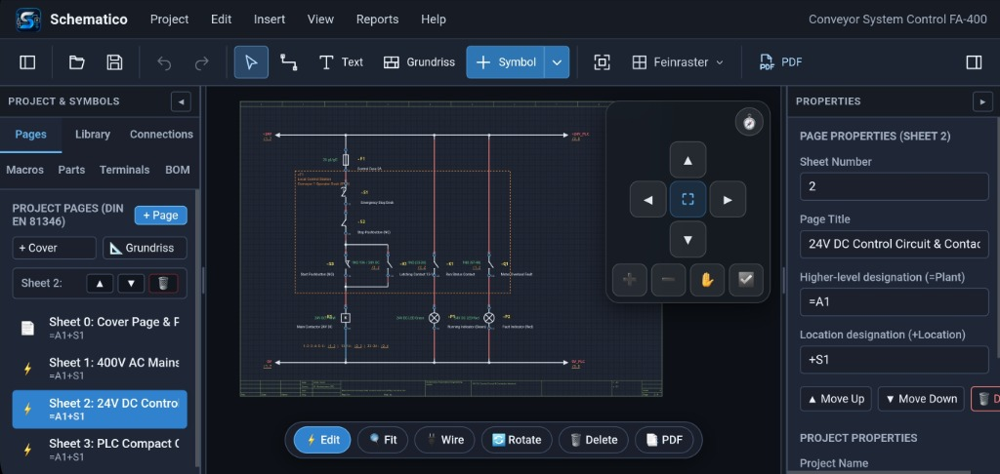
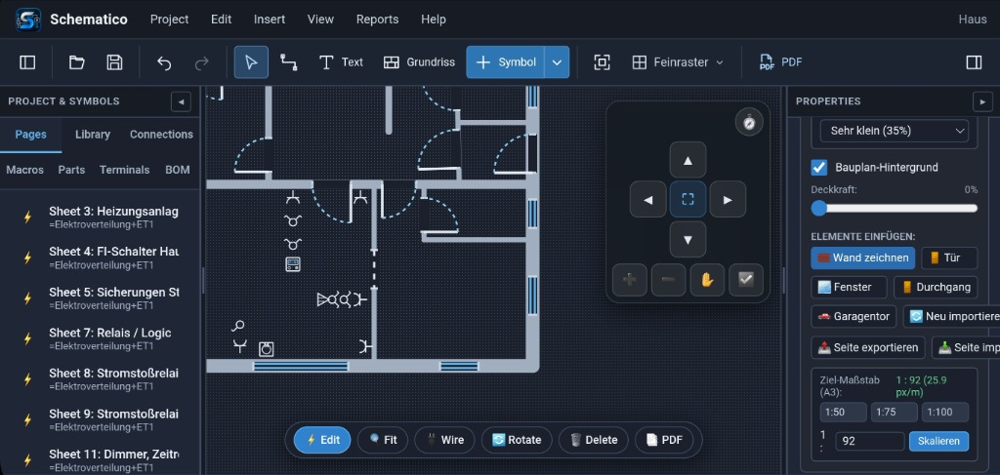
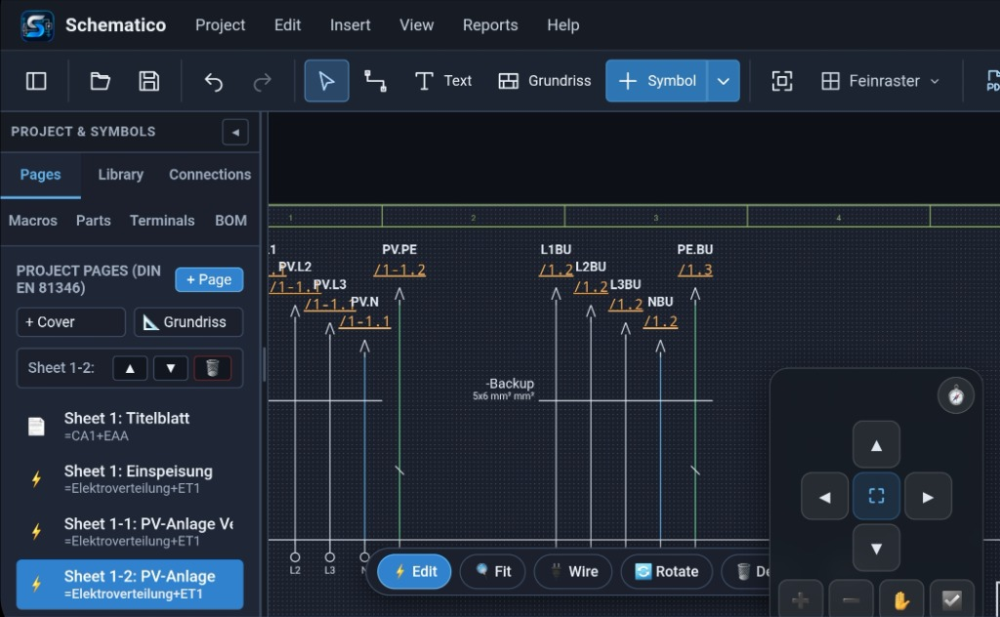
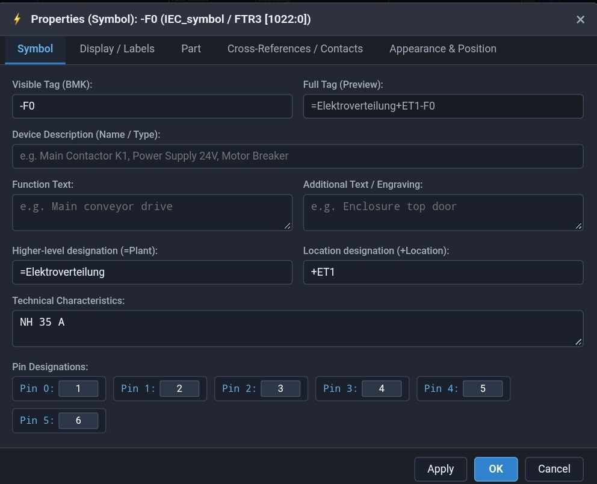
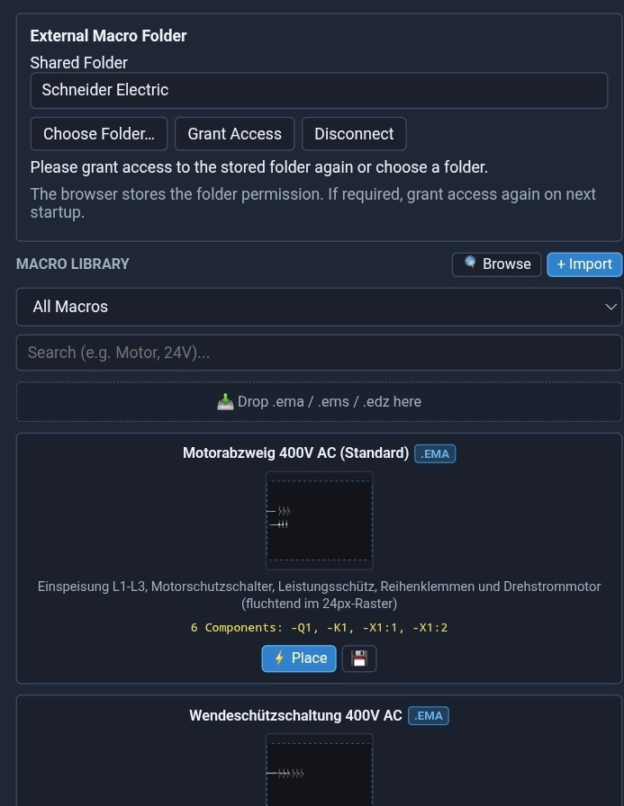
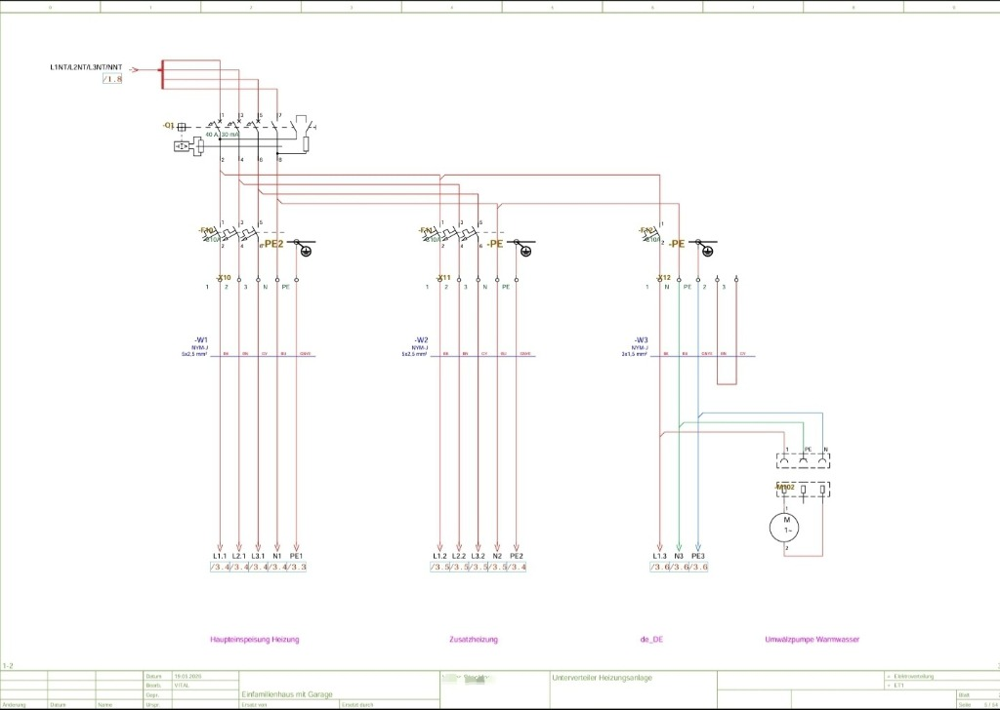
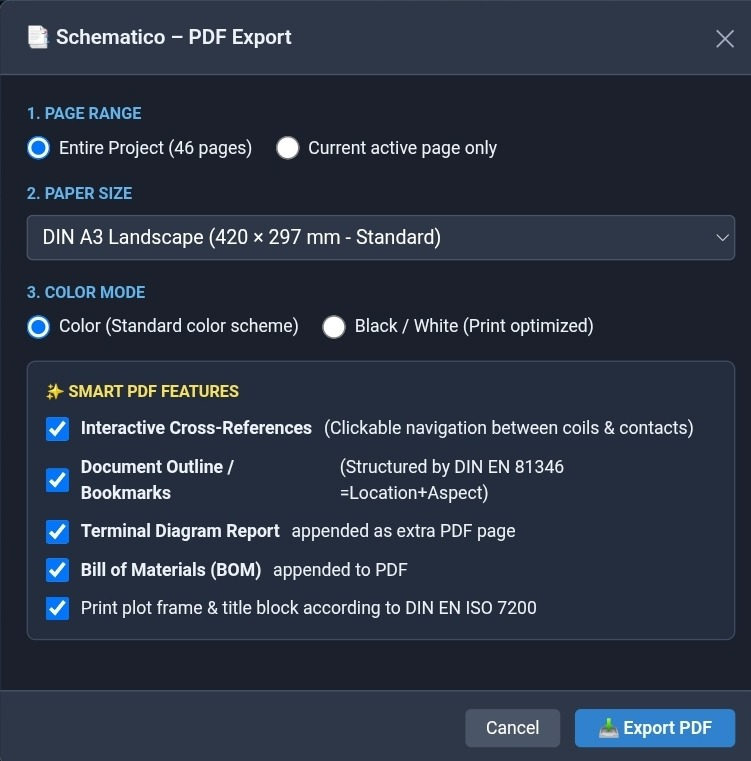

<p align="center">
  <a href="https://vitals5.github.io/schematico/">
    
  </a>
</p>

<p align="center">
  <strong>Professional Schematic Diagrams &amp; Architectural Electrical CAD for Windows and Modern Web Browsers</strong>
</p>

<p align="center">
  <a href="https://github.com/vitals5/schematico/releases/latest"></a>
  <a href="https://vitals5.github.io/schematico/"></a>
  <a href="https://github.com/vitals5/schematico/actions/workflows/build-windows.yml"></a>
  <a href="LICENSE"></a>
  <a href="#supported-standards"></a>
</p>

<p align="center">
  <a href="https://vitals5.github.io/schematico/"><strong>🚀 Launch Web App</strong></a> •
  <a href="https://github.com/vitals5/schematico/releases/latest"><strong>💾 Windows Download (.exe)</strong></a> •
  <a href="https://vitals5.github.io/schematico/landing.html"><strong>🌐 Interactive Landing Page</strong></a> •
  <a href="#highlights--features"><strong>✨ Feature Overview</strong></a>
</p>

---

## About Schematico

**Schematico** is an open-source CAE and CAD suite engineered for electrical engineers, control panel builders, master electricians, and automation specialists.

The software unites two essential electrical engineering workflows into one modern, responsive interface:
1. **Industrial Schematic Diagrams:** Multi-sheet circuit and control schematics adhering to international engineering standards, featuring directional wire autoconnect, dynamic contact mirrors, and sheet-spanning cross-references.
2. **Architectural Electrical Installation:** Scaled floor plans with configurable wall thicknesses, windows, doors, over 66 standardized installation symbols, and elegant curved wiring routes (*arcWires*).

### Supported Standards
- **DIN EN 81346-1 / DIN EN 81346-2:** Structuring principles and reference designation system (RDS / BMK: `=Plant +Location -Device:Terminal`).
- **IEC 60617 / DIN EN 60617:** Graphical symbols for circuit diagrams (switching devices, contactors, motors, transformers, protection gear, PLC modules).
- **DIN EN 60617-11:** Architectural and building installation diagrams (switches, power sockets, sensors, automation actuators, distribution boards).
- **DIN EN ISO 7200:** Standardized title blocks with automated multi-sheet project metadata synchronization.

---

## Screenshot Gallery

<!-- ======================================================================= -->
<!-- SCREENSHOT 1: Main Editor (Industrial Schematic Diagram)                -->
<!-- ======================================================================= -->
<div align="center">
  <div style="border: 1px solid #30363d; border-radius: 10px; background: #0d1117; padding: 12px; margin: 20px 0; max-width: 960px;">
    <p align="left" style="margin: 0 0 10px 4px; font-family: monospace; font-size: 12px; color: #8b949e;">
      🔴 &nbsp; 🟡 &nbsp; 🟢 &nbsp; <b>schematico — 24V_dc_control_circuit.sch</b>
    </p>
    <a href="docs/screenshots/01-schematic-editor.png">
      
    </a>
    <p align="center" style="margin: 10px 0 2px 0; font-size: 13px; color: #8b949e;">
      <i>Main Editor: Multi-sheet project structure (DIN EN 81346), control schematic with autoconnect, contactors, indicators, and live property inspector.</i>
    </p>
  </div>
</div>

---

## Highlights &amp; Features

### 1. Industrial Schematics &amp; Intelligent Wiring Logic
- **Component Placement &amp; Grid:** Place, rotate, and align components on a standard 8 mm grid with optional 4 mm half-grid precision.
- **Directional Ports &amp; Autoconnect:** Component pins feature directional connection vectors (`top`, `bottom`, `left`, `right`). Aligned ports automatically connect upon placement. Orthogonal routing calculates clean paths with standard clearance.
- **Junctions &amp; Jumpers:** Automated T-junctions on wire splits and optical wire bridges to eliminate ambiguous net crossings.
- **Cable Definitions &amp; Core Colors:** Assign multi-conductor cables (e.g. `NYM-J 5x1.5`, `ÖLFLEX 4G2.5`) across crossing lines with core color codes and shielding.
- **Location Boxes (+S1 / +ET1):** Spatial and functional device grouping for enclosures, control desks, and field junction boxes with customizable bounding borders.

<!-- ======================================================================= -->
<!-- SCREENSHOT 2: Architectural Floor Plan & Electrical Installation       -->
<!-- ======================================================================= -->
<div align="center">
  <div style="border: 1px solid #30363d; border-radius: 10px; background: #0d1117; padding: 12px; margin: 20px 0; max-width: 960px;">
    <p align="left" style="margin: 0 0 10px 4px; font-family: monospace; font-size: 12px; color: #8b949e;">
      🔴 &nbsp; 🟡 &nbsp; 🟢 &nbsp; <b>schematico — floor_plan_installation_ground_floor.sch</b>
    </p>
    <a href="docs/screenshots/02-installation-plan.png">
      
    </a>
    <p align="center" style="margin: 10px 0 2px 0; font-size: 13px; color: #8b949e;">
      <i>Building &amp; Electrical Installation (DIN EN 60617-11): Scaled floor plan with wall thicknesses, doors, windows, multi-gang socket combos, and switches.</i>
    </p>
  </div>
</div>

### 2. Architectural Floor Plans &amp; Installation Diagrams (DIN EN 60617-11)
Schematico provides a dedicated **Installation Plan Page Type** for residential, commercial, and industrial facilities:
- **Floor Plan Import &amp; 2-Click Calibration:** Load building plans (`PNG`, `JPEG`, `PDF`) directly onto the canvas. Calibrate real-world scale in seconds: click two reference points (e.g. an exterior wall), enter the distance in meters, or select standard architectural scales (1:50, 1:75, 1:100 for DIN A3).
- **Distortion-Free Rescaling:** Change scale anytime (e.g. from 1:75 to 1:50). Walls, openings, symbols, and dimensions scale proportionally and reliably.
- **Walls, Doors &amp; Windows:**
  - **Walls:** Draw with standardized wall thicknesses (11.5 cm, 17.5 cm, 24 cm, 36.5 cm) with orthogonal snapping and miter corner merging.
  - **Doors:** Configurable doors with wall opening cutouts, frame ticks, door leaf, and swing arc per DIN Left / DIN Right (`left_in`, `right_in`, `left_out`, `right_out`, pocket sliding door).
  - **Windows:** Double-glazed architectural representation with jamb boundaries.
  - **Sectional Doors:** Garage doors with slats and ceiling guide rails.
- **Over 66 Installation Symbols per DIN EN 60617-11:**
  - **Sockets:** Single, double, triple, 4-gang, and 5-gang horizontally and vertically combined. Includes IP44 wet-room, switched, and USB outlets.
  - **Switches:** Single-pole, two-way, intermediate, series, pushbuttons, and dimmers.
  - **Smart Home &amp; Building Automation:** Neutral bus symbols for 2-gang/4-gang push-button sensors, room temperature controllers (RTC with LCD display), touch panels, 360° presence detectors, and magnetic window contacts (KNX, Loxone, DALI, Modbus).
  - **Lighting &amp; Power:** Ceiling lights, wall sconces, downlights, LED strips, emergency lights, CEE 16A/32A high-voltage sockets, sub-distribution boards, and meter cabinets.
  - **Telecom &amp; Safety:** Network outlets (RJ45 Cat.6a/Cat.7), TV/SAT jacks, intercoms, smoke alarms, and main equipotential bonding bars (PE/PAS).
- **Magnetic Wall Snapping:** Devices snap magnetically to the nearest wall surface and align parallel or perpendicular automatically.
- **Curved Routing Lines (`arcWires`):** Connect switches, outlets, and fixtures with smooth Bézier arcs. Assign circuit tag (`F1 / W1`), phase (`L1`, `L2`, `L3`), cable type, and wire color.

<!-- ======================================================================= -->
<!-- SCREENSHOT 3: Intelligent Cross-References & Interruption Points         -->
<!-- ======================================================================= -->
<div align="center">
  <div style="border: 1px solid #30363d; border-radius: 10px; background: #0d1117; padding: 12px; margin: 20px 0; max-width: 960px;">
    <p align="left" style="margin: 0 0 10px 4px; font-family: monospace; font-size: 12px; color: #8b949e;">
      🔴 &nbsp; 🟡 &nbsp; 🟢 &nbsp; <b>schematico — pv_system_interruption_points.sch</b>
    </p>
    <a href="docs/screenshots/03-cross-references.png">
      
    </a>
    <p align="center" style="margin: 10px 0 2px 0; font-size: 13px; color: #8b949e;">
      <i>Intelligent Cross-References: Automatic sheet and column references (/1-1.2, /1.2) with cable bundle definitions (-Backup 5x6 mm²).</i>
    </p>
  </div>
</div>

### 3. Bidirectional Cross-References &amp; Fast Navigation
- **Direct Navigation via Ctrl + Click:** Hold `Ctrl` and click any coil, contact, interruption point, or installation symbol to instantly jump to its reference target on any project sheet.
- **Inspector Quick Navigation:** The properties inspector displays all linked targets with one-click navigation buttons.
- **Interactive PDF Hyperlinks:** Vector PDF exports include full PDF annotation links for one-click navigation across the entire drawing set in any standard viewer.

<!-- ======================================================================= -->
<!-- SCREENSHOT 4: Property Inspector & Device Tagging                       -->
<!-- ======================================================================= -->
<div align="center">
  <div style="border: 1px solid #30363d; border-radius: 10px; background: #0d1117; padding: 12px; margin: 20px 0; max-width: 960px;">
    <p align="left" style="margin: 0 0 10px 4px; font-family: monospace; font-size: 12px; color: #8b949e;">
      🔴 &nbsp; 🟡 &nbsp; 🟢 &nbsp; <b>schematico — symbol_properties_dialog.sch</b>
    </p>
    <a href="docs/screenshots/04-properties-inspector.png">
      
    </a>
    <p align="center" style="margin: 10px 0 2px 0; font-size: 13px; color: #8b949e;">
      <i>Properties Modal: Standard device tag (-F0), full hierarchical designation (=Plant+Location-F0), terminal pin mappings, and technical characteristics.</i>
    </p>
  </div>
</div>

### 4. Standard Device Tagging &amp; Property Inspector (DIN EN 81346-2)
- **Hierarchical Device Tagging:** Full structure support for plant (`=`), location (`+`), and device reference designator (`-`).
- **Comprehensive Technical Data:** Manage function descriptions, engraving texts, electrical ratings (e.g. `NH 35 A`), and pin designators (1 to 6).
- **Display &amp; Engraving Control:** Granular control over font sizing, positioning, text alignments, and individual field visibility.

<!-- ======================================================================= -->
<!-- SCREENSHOT 5: High-Capacity Macro Library                               -->
<!-- ======================================================================= -->
<div align="center">
  <div style="border: 1px solid #30363d; border-radius: 10px; background: #0d1117; padding: 12px; margin: 20px 0; max-width: 960px;">
    <p align="left" style="margin: 0 0 10px 4px; font-family: monospace; font-size: 12px; color: #8b949e;">
      🔴 &nbsp; 🟡 &nbsp; 🟢 &nbsp; <b>schematico — macro_library_browser.sch</b>
    </p>
    <a href="docs/screenshots/05-macro-library.png">
      
    </a>
    <p align="center" style="margin: 10px 0 2px 0; font-size: 13px; color: #8b949e;">
      <i>Macro Browser: Connect local manufacturer folders (e.g. Schneider Electric), live search, and drag-and-drop placement of window macros (.EMA) and page macros (.EMS).</i>
    </p>
  </div>
</div>

### 5. High-Capacity Macro Library
- Connect external directories containing macro collections with zero performance lag.
- Fast preview, search filtering, and drag-and-drop placement for:
  - Window macros (`.ema`)
  - Page macros (`.ems`)
  - Component packages (`.edz`)
  - 2D enclosure and mounting outlines (`.fp1`)
- Adjust parametric macro variables and device tags directly prior to placement.

### 6. Multi-Sheet Project Management &amp; Title Block Sync
- Structure complex projects across cover sheets, circuit schematics, architectural installation plans, and parts lists.
- **Automated Metadata Synchronization:** Central project parameters (project name, commission, plant, location, author, date, revision) synchronize live across all title blocks (DIN EN ISO 7200) and cover forms.
- Reorder pages via quick navigation buttons with automatic sheet renumbering.
- Export and import individual installation or schematic sheets as JSON for modular reuse.

### 7. Print-Ready Vector PDF Exports &amp; Bill of Materials (BOM)
- Generate razor-sharp vector PDFs in DIN A3 and DIN A4 (landscape or portrait).
- Switch between full-color and high-contrast monochrome printing modes.
- Fully linked cross-reference navigation for interactive digital reviews.
- Automated Bill of Materials (BOM) generation with part numbers, manufacturers, ratings, and quantity rollups.

<!-- ======================================================================= -->
<!-- SCREENSHOT 6: Print-Ready Vector PDF Export                             -->
<!-- ======================================================================= -->
<div align="center">
  <div style="border: 1px solid #30363d; border-radius: 10px; background: #0d1117; padding: 12px; margin: 20px 0; max-width: 960px;">
    <p align="left" style="margin: 0 0 10px 4px; font-family: monospace; font-size: 12px; color: #8b949e;">
      🔴 &nbsp; 🟡 &nbsp; 🟢 &nbsp; <b>schematico — export_heating_distribution.pdf (DIN A3)</b>
    </p>
    <a href="docs/screenshots/06-pdf-export-sheet.png">
      
    </a>
    <p align="center" style="margin: 10px 0 2px 0; font-size: 13px; color: #8b949e;">
      <i>Print-Ready Vector PDF Export: DIN A3 landscape with standardized title block (DIN EN ISO 7200), power rails, RCDs, motor circuits, and clickable cross-references.</i>
    </p>
  </div>
</div>

<!-- ======================================================================= -->
<!-- SCREENSHOT 7: Smart PDF Export Dialog                                   -->
<!-- ======================================================================= -->
<div align="center">
  <div style="border: 1px solid #30363d; border-radius: 10px; background: #0d1117; padding: 12px; margin: 20px 0; max-width: 640px;">
    <p align="left" style="margin: 0 0 10px 4px; font-family: monospace; font-size: 12px; color: #8b949e;">
      🔴 &nbsp; 🟡 &nbsp; 🟢 &nbsp; <b>schematico — export_settings_dialog.sch</b>
    </p>
    <a href="docs/screenshots/07-pdf-export-dialog.png">
      
    </a>
    <p align="center" style="margin: 10px 0 2px 0; font-size: 13px; color: #8b949e;">
      <i>Smart PDF Export Dialog: Batch processing for entire multi-page projects (46 pages), DIN A3 / A4, color schemes, bookmarks, and automated Bill of Materials (BOM).</i>
    </p>
  </div>
</div>

### 8. PWA, Tablet &amp; Touch Optimization
- **Offline-First &amp; Installable:** Install as a Progressive Web App (PWA) directly on tablets (iPad, Android, Surface) and desktops.
- **Fluid Gesture Controls:** Smooth panning and two-finger pinch-to-zoom centered on gesture coordinates.
- **HUD Magnifier Preview:** Dragging components, walls, or openings automatically activates a magnified loupe preview in the opposite corner of the viewport to keep target snap points unobstructed.

---

## Comparison: Schematico vs. Alternatives

| Feature / Capability | Schematico | Simple Vector Tools (Visio, Draw.io) | Heavyweight Enterprise CAE |
| :--- | :---: | :---: | :---: |
| **Electrical Logic &amp; Autoconnect** | **✓ Yes** (Directional Vectors) | ✗ No (Pure graphical lines) | ✓ Yes |
| **Contact Mirrors &amp; Cross-References** | **✓ Yes** (Automated &amp; interactive) | ✗ Manual text typing | ✓ Yes |
| **Building Installation (DIN EN 60617-11)** | **✓ Fully Integrated** | ▲ Incomplete generic stencils | ▲ Expensive extra module |
| **Curved Routing Lines (arcWires)** | **✓ Yes** (Smooth &amp; taggable) | ✗ Cumbersome manual drawing | ▲ Limited |
| **Macro Compatibility (.ema, .ems)** | **✓ Yes** (Extensive Libraries) | ✗ No | ✓ Yes |
| **Supported Platforms** | **Windows Desktop &amp; Web (PWA)** | Mostly Web only | Mostly Windows Desktop only |
| **Offline Operation &amp; Privacy** | **100% Local** (Zero cloud dependency) | ▲ Cloud storage required | 100% Local |
| **License &amp; Cost** | **Free &amp; Open Source (MIT)** | Freemium / Monthly subscriptions | Very costly multi-thousand € licenses |

---

## Keyboard Shortcuts

| Shortcut | Scope | Function |
| :--- | :--- | :--- |
| **Ctrl + Click** | Canvas | Jump directly to cross-reference partner on any page |
| **Ctrl + A** | Canvas | Select all elements on current page |
| **Ctrl + G** / **Ctrl + Shift + G** | Canvas | Create permanent group / Dissolve group |
| **Ctrl + C** / **Ctrl + X** / **Ctrl + V** | Canvas | Copy / Cut / Paste |
| **Ctrl + D** | Canvas | Duplicate selection with automated BMK index increment |
| **Ctrl + Z** / **Ctrl + Y** | Canvas | Undo / Redo |
| **Delete** / **Backspace** | Canvas | Delete selected components, wires, walls, or texts |
| **F2** / **Enter** | Canvas | Open properties modal or focus inspector |
| **R** | Canvas | Rotate selected element 90° clockwise |
| **D** / **W** | Canvas | Switch to wire drawing mode |
| **Insert** | Canvas | Open symbol catalog |
| **F** | Canvas | Fit entire sheet to viewport |
| **H** | Canvas | Toggle between full grid (8 mm) and half grid (4 mm) |
| **Middle Click + Drag** | Canvas | Pan drawing area |
| **Mouse Wheel** | Canvas | Smooth zoom relative to cursor position |
| **Esc** | Canvas | Cancel active tool / Deselect all |

---

## Supported File Formats

### Import
- **Schematico Projects:** Native JSON format (`.json`).
- **Standard Archive Packages:** Unpack `.zw1`, `.zip`, and split multi-part archives (`.001`, `.002`) directly in the browser via integrated WebAssembly 7-Zip.
- **Macros &amp; Components:** Window macros (`.ema`), page macros (`.ems`), component data (`.edz`), and 2D cabinet outlines (`.fp1`).
- **Floor Plans &amp; Blueprints:** Architectural graphics (`PNG`, `JPEG`, `WebP`, `PDF`).

### Export
- **Print-Ready Vector PDF:** High-resolution DIN A3/A4 documents with clickable cross-reference hyperlinks.
- **Native JSON Project:** Complete, lossless project backups containing symbol master data, nets, and metadata.
- **Bill of Materials (BOM):** Tabular parts list exports and formatted PDF reports.
- **Macro Export:** Export selected circuit elements as `.ema` or entire sheets as `.ems`.

---

## Development &amp; Build

### Prerequisites
- **Node.js 22 or higher**
- **npm**

### Quickstart

```bash
# Clone repository
git clone https://github.com/vitals5/schematico.git
cd schematico

# Install dependencies
npm ci

# Start local development server with hot reload
npm run dev
```

The application runs locally at `http://localhost:5173`.

### Testing &amp; Building

```bash
# Run comprehensive automated test suite
npm test

# Create production web bundle (Vite + TypeScript)
npm run build

# Preview production build locally
npm run preview

# Package Windows installer & portable executable
npm run dist:win
```

---

## Desktop Application (Windows)

Schematico can be compiled as a native desktop application for Windows:
- **`Schematico-Setup-<version>.exe`**: Guided installer with Start Menu and Desktop shortcuts.
- **`Schematico-<version>.exe`**: Standalone portable version requiring no administrator privileges.

Automated releases are compiled and deployed via GitHub Actions on every tag push (`v*`).

---

## License

Schematico is open-source software licensed under the [MIT License](LICENSE).  
The embedded WebAssembly 7-Zip decompression library is distributed under the LGPL (see [public/licenses/7zip-wasm.txt](public/licenses/7zip-wasm.txt)).
