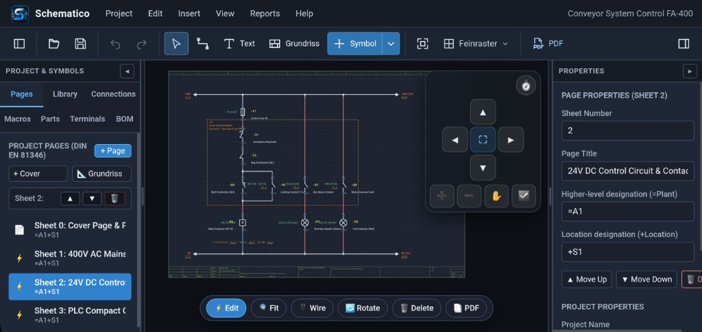
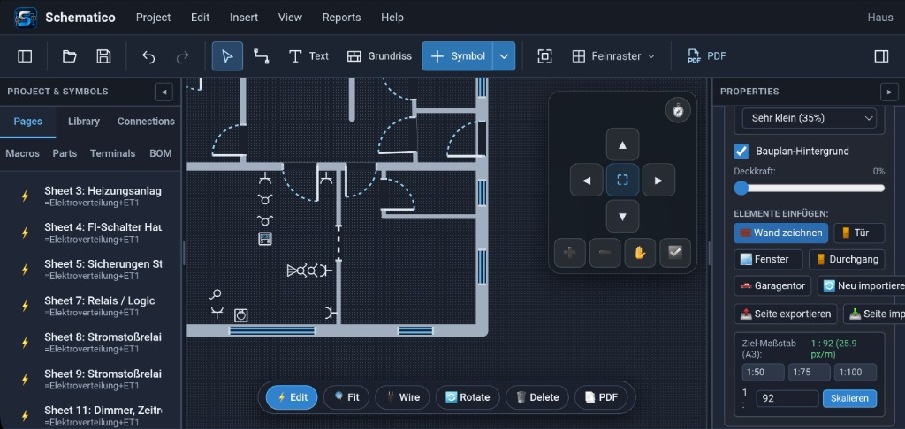
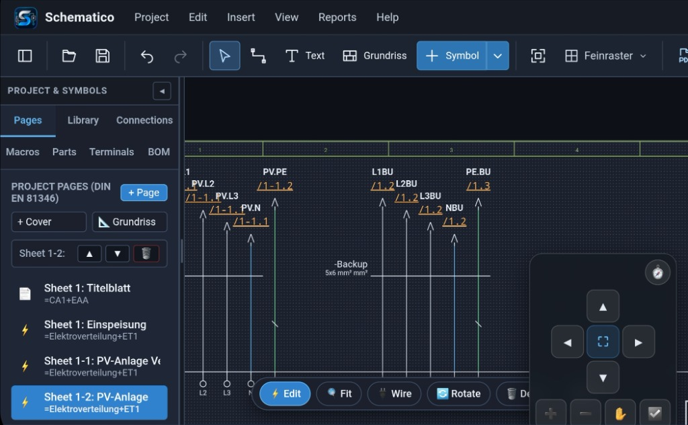
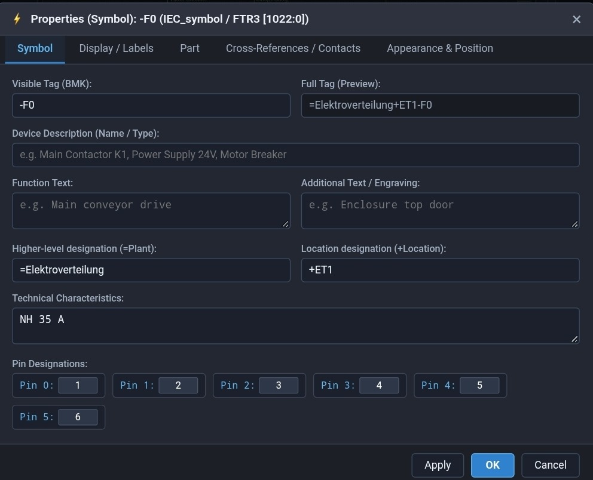
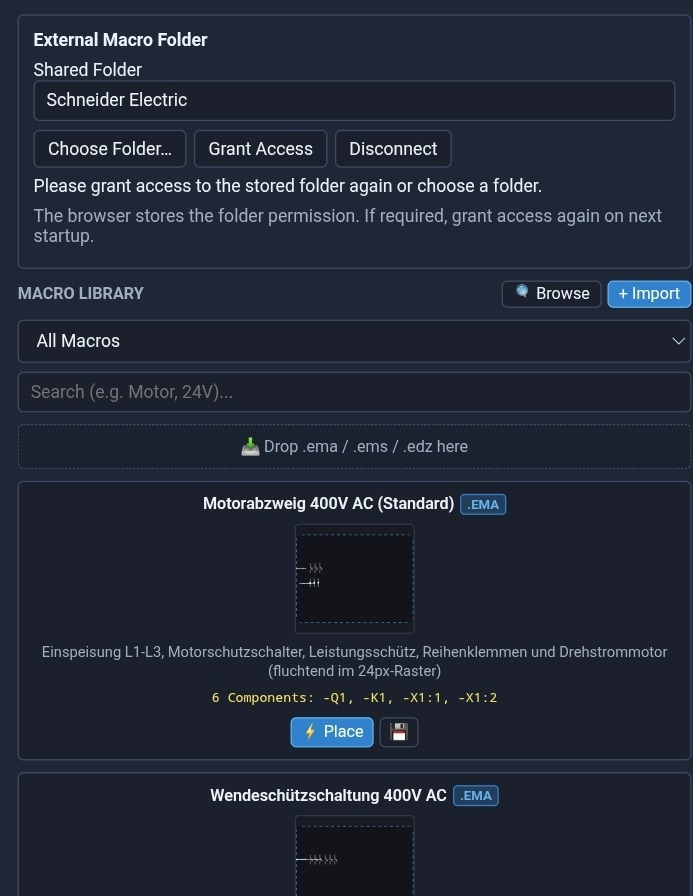
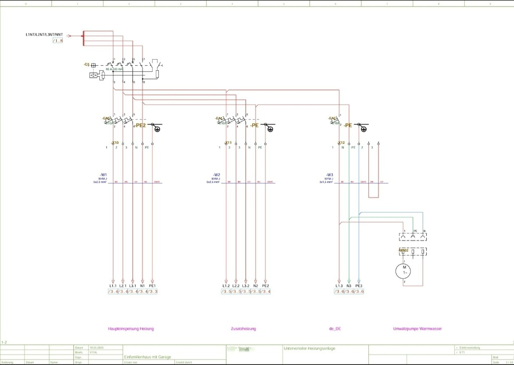
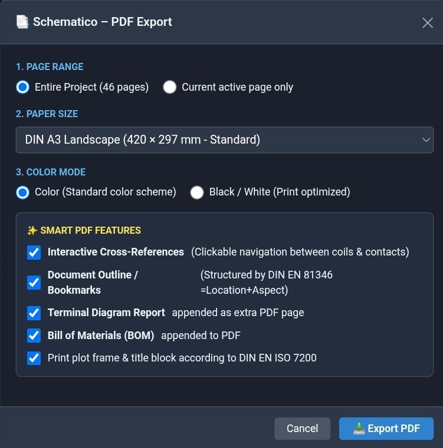

<p align="center">
  <a href="https://vitals5.github.io/schematico/">
    <picture>
      <source media="(prefers-color-scheme: dark)" srcset="public/branding/schematico-banner-dark.png">
      <source media="(prefers-color-scheme: light)" srcset="public/branding/schematico-banner-light.png">
      
    </picture>
  </a>
</p>

<p align="center">
  <strong>Professional Schematic Diagrams &amp; Architectural Electrical CAD for Windows, Linux and Modern Web Browsers</strong>
</p>

<p align="center">
  <a href="https://github.com/vitals5/schematico/releases/latest"></a>
  <a href="https://vitals5.github.io/schematico/"></a>
  <a href="https://github.com/vitals5/schematico/actions/workflows/build-windows.yml"></a>
  <a href="https://github.com/vitals5/schematico/actions/workflows/build-linux.yml"></a>
  <a href="LICENSE"></a>
  <a href="#supported-standards"></a>
</p>

<p align="center">
  <a href="https://vitals5.github.io/schematico/"><strong>🚀 Launch Web App</strong></a> •
  <a href="https://github.com/vitals5/schematico/releases/latest"><strong>💾 Windows Download (.exe)</strong></a> •
  <a href="https://github.com/vitals5/schematico/releases/latest"><strong>🐧 Linux Download (.AppImage / .deb)</strong></a> •
  <a href="https://vitals5.github.io/schematico/landing.html"><strong>🌐 Interactive Landing Page</strong></a> •
  <a href="#highlights--features"><strong>✨ Feature Overview</strong></a>
</p>

---

## AI providers and models

Open **AI & MCP → KI-Anbieter & Modell (BYOK)** or the assistant's gear button. Select **OpenRouter**, enter your own API key, click **Modelle aktualisieren**, choose a model and save. The searchable list comes from OpenRouter's API and includes models advertising tool support; it is cached locally and can be refreshed at any time. Google Gemini remains available as an alternative.

Keys, provider choice and model selection are stored locally in the browser or desktop profile, outside project files. Requests and the required drawing context go directly to the chosen provider. Model availability, pricing and usage limits depend on your OpenRouter account and the underlying provider. The connection test checks the key without generating a paid completion; an actual CAD request also requires an available model with tool support. Floor plan recognition additionally requires image support. The chat paperclip accepts images and PDFs as prompt references, with previews and removal before sending; choose a model advertising the corresponding input support. See [chat attachments](docs/ai-attachments.md) for limits and data handling.

Failed assistant actions now provide **Fehlerdetails anzeigen**, **Kurzbericht kopieren**, and **Fehlerbericht herunterladen**. The JSON report includes the failed arguments, project snapshot, model, app version and error phase for reproduction. Credentials are redacted; project and prompt data remain in the file. See [AI error reports](docs/ai-diagnostics.md).

## Checked schematic layout

The drawing assistant can propose complete circuits using library symbols, pin-to-pin connections and functional groups **without coordinates**. ELK graph placement, obstacle-aware orthogonal routing and an independent validator produce layout previews. Existing sheets or a selection can also be optimized while keeping objects fixed.

Automatic layouts start with whole-net Autoconnect construction: measured devices, actual library corners/T-pieces and connection directions determine the available rows and routing bands. If a complete construction does not fit, the planner tries additional sheets instead of accepting routed substitutes. Every visible connection, including both sides of a sheet reference, must be reproduced by the real Autoconnect detector without waypoints. Incomplete proposals cannot be applied; the legacy `preferAutoconnect: false` option cannot bypass the requirement. Manual editing and project import remain available.

Mixed device ports use measured, editable library elbows to bring side contacts into the reserved connection bands without replacing or scaling the original symbol. Neutral/protective return nets preserve their electrical connections without imposing a phase-flow hierarchy. Room-level planning groups are also tried as complete sheet units before finer partitions. Construction failures report their actual cause; a split estimate is not presented as proof of sheet overflow.

New AI functional groups are planning hints: when more sheets are needed, flat groups can form sheet-local fragments retaining their common origin and complete membership. `keepTogether: true`, nested groups, imported groups and existing manual groups remain atomic. Apply audits all original contact nets across the references, including separation of different nets with identical potential labels.

Existing aligned circuits first try a label-only repair: symbol positions, font sizes, cables and core assignments stay intact while component labels and unlocked free texts are moved within the sheet. This can optimize imported sheets with cable definitions without splitting them. The shared validator checks painted box contents separately from external port-routing reservations, and Autoconnect detection supports connections spanning the actual sheet dimensions. If this repair is insufficient, the general layout pipeline still runs; automatic multi-sheet distribution of cable definitions remains unsupported.

Long equipment labels in new non-socket AI drafts use display-only word wrapping; the stored text and font size remain unchanged. Multi-sheet planning also compares bounded electrical graph partitions to reduce sheet-to-sheet connections. Balanced partition candidates prevent highly connected tails from accumulating on one sheet. Automatic AI plans can compare up to 24 sheets; every accepted sheet still requires a complete checked Autoconnect construction.

Existing circuits can also be copied exactly to another page using `duplicate_schematic_page`, retaining their native library symbols and connections.

Only **Übernehmen / Apply** changes a layout proposal, as one undo step. Infeasible layouts return explicit issues and a proposed group split instead of shrinking symbols or fonts. Full-sheet utilization alone is not a quality guarantee. See [layout workflow, MCP tools and limitations](docs/layout.md).

## Shared project identity index

BMK plausibility checks, contact mirrors, reference navigation and terminal reports use a common derived index of pages, placements, ports, structure designations and article assignments. Identical tags in different plant/location contexts remain separate; blank tags do not create a device group. The read-only MCP tool `get_project_index` returns the same inspection messages as the UI.

Existing project JSON files need no migration. Designation groups are candidate identities, not verified physical-device counts. Imported device parts are treated conservatively. See [project index and limitations](docs/project-index.md).

The shared static conductor service follows permanent library port groups, wires and named sheet continuations. Separate phases and crossing paths remain distinct; equal potential names alone do not connect nets. Terminal reports trace routing pieces to their actual equipment targets, and layout application checks the original project-wide conductor partition. `get_electrical_nets` exposes the same topology and inspection messages to the assistant. Conditional contacts are not simulated; unknown import semantics remain unknown. See [electrical net service](docs/electrical-nets.md).

## Electrical project inspection

Electrical project inspection now uses one rule service across the editor, imports and AI tools. Findings include stable rule/cause IDs and precise sheet, component, pin and wire locations. Configure required/reserve ports, fixed potential constraints and part/reference policies in component properties. The inspection dialog supports navigation, refresh and a downloadable JSON report; `validate_electrical_project` provides the same findings to AI clients. Geometry remains a separate validation result. See [electrical inspection and coverage](docs/electrical-inspection.md). The review dialog also filters and groups findings by rule, page, full designation context and article-data provenance. Import records distinguish unread article data from an inspected empty field; grouping never assigns parts or confirms device identities. AI clients can page through the same groups with `get_inspection_review`.

Native project imports can also preserve embedded part masters and source references, linking them by original function identity. Variants, additional parts, zero/unknown quantities and unplaced references remain available; properties and BOM/PDF use the preserved data. The Project menu can reconcile missing article data from an original archive into an edited drawing, with scoped source identities, a conflict preview, explicit confirmation for older source records and a single undo step. See [imported articles and quantity limitations](docs/imported-articles.md).

The article workbench edits main/accessory assignments, stores a local IndexedDB catalog with CSV/JSON exchange, opens filtered inspection findings for batch correction, and checks recorded function/pin specifications. Explicitly confirmed main/secondary device links prevent duplicate BOM counting; used catalog snapshots travel with the project. See [article workbench and device counting](docs/article-workbench.md).

The device navigator manages planned devices and links to placed main/secondary representations. Terminal/cable tools correct sides, levels, bridges, reserve cores and wire assignments, and export manufacturing CSV lists. Function specifications use a table editor. See [device and wiring workflows](docs/device-and-wiring-tools.md). An optional [team catalog service](docs/team-catalog.md) adds personal read/write access, immutable SQLite revisions and conflict-aware synchronization; local operation remains available.

Evidence-based cable repair proposals, BMEcat manufacturer imports and exact article-function suggestions help resolve inspection findings. Confirmed device identities govern cross-references and PDF links. Central potential definitions preview controlled propagation of conductor names, colors and cross-sections without changing net connectivity. Each applied proposal supports undo. Article-wise snapshot updates preserve quantities and accessories. Explicit repeated function views and required representations are checked per confirmed device. The saved inspection worklist tracks reasons and baseline comparisons without hiding electrical findings. See [engineering review assistants](docs/engineering-assistants.md).

## About Schematico

**Schematico** is an open-source CAE and CAD suite engineered for electrical engineers, control panel builders, master electricians, and automation specialists.

The software unites two essential electrical engineering workflows into one modern, responsive interface:
1. **Industrial Schematic Diagrams:** Multi-sheet circuit and control schematics adhering to international engineering standards, featuring directional wire autoconnect, dynamic contact mirrors, and sheet-spanning cross-references.
2. **Architectural Electrical Installation:** Scaled floor plans with configurable wall thicknesses, windows, doors, over 66 standardized installation symbols, and elegant curved wiring routes (*arcWires*).

### Supported Standards
- **DIN EN 81346-1 / DIN EN 81346-2:** Structuring principles and reference designation system (RDS / BMK: `=Plant +Location -Device:Terminal`).
- **IEC 60617 / DIN EN 60617:** Graphical symbols for circuit diagrams (switching devices, contactors, motors, transformers, protection gear, PLC modules).
- **DIN EN 60617-11:** Architectural and building installation diagrams (switches, power sockets, sensors, automation actuators, distribution boards).
- **DIN EN ISO 7200:** Standardized title blocks with automated multi-sheet project metadata synchronization.

---

## Screenshot Gallery

<!-- ======================================================================= -->
<!-- SCREENSHOT 1: Main Editor (Industrial Schematic Diagram)                -->
<!-- ======================================================================= -->
<div align="center">
  <div style="border: 1px solid #30363d; border-radius: 10px; background: #0d1117; padding: 12px; margin: 20px 0; max-width: 960px;">
    <p align="left" style="margin: 0 0 10px 4px; font-family: monospace; font-size: 12px; color: #8b949e;">
      🔴 &nbsp; 🟡 &nbsp; 🟢 &nbsp; <b>schematico — 24V_dc_control_circuit.sch</b>
    </p>
    <a href="docs/screenshots/01-schematic-editor.png">
      
    </a>
    <p align="center" style="margin: 10px 0 2px 0; font-size: 13px; color: #8b949e;">
      <i>Main Editor: Multi-sheet project structure (DIN EN 81346), control schematic with autoconnect, contactors, indicators, and live property inspector.</i>
    </p>
  </div>
</div>

---

## Highlights &amp; Features

### 1. Industrial Schematics &amp; Intelligent Wiring Logic
- **Component Placement &amp; Grid:** Place, rotate, and align components on a standard 8 mm grid with optional 4 mm half-grid precision.
- **Directional Ports &amp; Autoconnect:** Component pins feature directional connection vectors (`top`, `bottom`, `left`, `right`). Aligned ports automatically connect upon placement. Orthogonal routing calculates clean paths with standard clearance.
- **Junctions &amp; Jumpers:** Automated T-junctions on wire splits and optical wire bridges to eliminate ambiguous net crossings.
- **Connection Editing:** T-piece, corner and crossing pin handles are hidden in the normal view and appear in wire mode. The electrical contacts remain available for snapping and Autoconnect.
- **Cable Definitions &amp; Core Colors:** Assign multi-conductor cables (e.g. `NYM-J 5x1.5`, `ÖLFLEX 4G2.5`) across crossing lines with core color codes and shielding.
- **Location Boxes (+S1 / +ET1):** Spatial and functional device grouping for enclosures, control desks, and field junction boxes with customizable bounding borders.

<!-- ======================================================================= -->
<!-- SCREENSHOT 2: Architectural Floor Plan & Electrical Installation       -->
<!-- ======================================================================= -->
<div align="center">
  <div style="border: 1px solid #30363d; border-radius: 10px; background: #0d1117; padding: 12px; margin: 20px 0; max-width: 960px;">
    <p align="left" style="margin: 0 0 10px 4px; font-family: monospace; font-size: 12px; color: #8b949e;">
      🔴 &nbsp; 🟡 &nbsp; 🟢 &nbsp; <b>schematico — floor_plan_installation_ground_floor.sch</b>
    </p>
    <a href="docs/screenshots/02-installation-plan.png">
      
    </a>
    <p align="center" style="margin: 10px 0 2px 0; font-size: 13px; color: #8b949e;">
      <i>Building &amp; Electrical Installation (DIN EN 60617-11): Scaled floor plan with wall thicknesses, doors, windows, multi-gang socket combos, and switches.</i>
    </p>
  </div>
</div>

### 2. Architectural Floor Plans &amp; Installation Diagrams (DIN EN 60617-11)
Schematico provides a dedicated **Installation Plan Page Type** for residential, commercial, and industrial facilities:
- **Floor Plan Import &amp; 2-Click Calibration:** Load building plans (`PNG`, `JPEG`, `PDF`) directly onto the canvas. Calibrate real-world scale in seconds: click two reference points (e.g. an exterior wall), enter the distance in meters, or select standard architectural scales (1:50, 1:75, 1:100 for DIN A3).
- **Distortion-Free Rescaling:** Change scale anytime (e.g. from 1:75 to 1:50). Walls, openings, symbols, and dimensions scale proportionally and reliably.
- **Walls, Doors &amp; Windows:**
  - **Walls:** Draw with standardized wall thicknesses (11.5 cm, 17.5 cm, 24 cm, 36.5 cm) with orthogonal snapping and miter corner merging.
  - **Doors:** Configurable doors with wall opening cutouts, frame ticks, door leaf, and swing arc per DIN Left / DIN Right (`left_in`, `right_in`, `left_out`, `right_out`, pocket sliding door).
  - **Windows:** Double-glazed architectural representation with jamb boundaries.
  - **Sectional Doors:** Garage doors with slats and ceiling guide rails.
- **Over 66 Installation Symbols per DIN EN 60617-11:**
  - **Sockets:** Single, double, triple, 4-gang, and 5-gang horizontally and vertically combined. Includes IP44 wet-room, switched, and USB outlets.
  - **Switches:** Single-pole, two-way, intermediate, series, pushbuttons, and dimmers.
  - **Smart Home &amp; Building Automation:** Neutral bus symbols for 2-gang/4-gang push-button sensors, room temperature controllers (RTC with LCD display), touch panels, 360° presence detectors, and magnetic window contacts (KNX, Loxone, DALI, Modbus).
  - **Lighting &amp; Power:** Ceiling lights, wall sconces, downlights, LED strips, emergency lights, CEE 16A/32A high-voltage sockets, sub-distribution boards, and meter cabinets.
  - **Telecom &amp; Safety:** Network outlets (RJ45 Cat.6a/Cat.7), TV/SAT jacks, intercoms, smoke alarms, and main equipotential bonding bars (PE/PAS).
- **Magnetic Wall Snapping:** Devices snap magnetically to the nearest wall surface and align parallel or perpendicular automatically.
- **Curved Routing Lines (`arcWires`):** Connect switches, outlets, and fixtures with smooth Bézier arcs. Assign circuit tag (`F1 / W1`), phase (`L1`, `L2`, `L3`), cable type, and wire color.

<!-- ======================================================================= -->
<!-- SCREENSHOT 3: Intelligent Cross-References & Interruption Points         -->
<!-- ======================================================================= -->
<div align="center">
  <div style="border: 1px solid #30363d; border-radius: 10px; background: #0d1117; padding: 12px; margin: 20px 0; max-width: 960px;">
    <p align="left" style="margin: 0 0 10px 4px; font-family: monospace; font-size: 12px; color: #8b949e;">
      🔴 &nbsp; 🟡 &nbsp; 🟢 &nbsp; <b>schematico — pv_system_interruption_points.sch</b>
    </p>
    <a href="docs/screenshots/03-cross-references.png">
      
    </a>
    <p align="center" style="margin: 10px 0 2px 0; font-size: 13px; color: #8b949e;">
      <i>Intelligent Cross-References: Automatic sheet and column references (/1-1.2, /1.2) with cable bundle definitions (-Backup 5x6 mm²).</i>
    </p>
  </div>
</div>

### 3. Bidirectional Cross-References &amp; Fast Navigation
- **Direct Navigation via Ctrl + Click:** Hold `Ctrl` and click any coil, contact, interruption point, or installation symbol to instantly jump to its reference target on any project sheet.
- **Inspector Quick Navigation:** The properties inspector displays all linked targets with one-click navigation buttons.
- **Interactive PDF Hyperlinks:** Vector PDF exports include full PDF annotation links for one-click navigation across the entire drawing set in any standard viewer.
- **Shared Library Graphics:** PDF exports use the editor's library symbol contours, connection positions, label anchors and stroke styles. Editing handles are excluded from the printed drawing.

<!-- ======================================================================= -->
<!-- SCREENSHOT 4: Property Inspector & Device Tagging                       -->
<!-- ======================================================================= -->
<div align="center">
  <div style="border: 1px solid #30363d; border-radius: 10px; background: #0d1117; padding: 12px; margin: 20px 0; max-width: 960px;">
    <p align="left" style="margin: 0 0 10px 4px; font-family: monospace; font-size: 12px; color: #8b949e;">
      🔴 &nbsp; 🟡 &nbsp; 🟢 &nbsp; <b>schematico — symbol_properties_dialog.sch</b>
    </p>
    <a href="docs/screenshots/04-properties-inspector.png">
      
    </a>
    <p align="center" style="margin: 10px 0 2px 0; font-size: 13px; color: #8b949e;">
      <i>Properties Modal: Standard device tag (-F0), full hierarchical designation (=Plant+Location-F0), terminal pin mappings, and technical characteristics.</i>
    </p>
  </div>
</div>

### 4. Standard Device Tagging &amp; Property Inspector (DIN EN 81346-2)
- **Hierarchical Device Tagging:** Full structure support for plant (`=`), location (`+`), and device reference designator (`-`).
- **Comprehensive Technical Data:** Manage function descriptions, engraving texts, electrical ratings (e.g. `NH 35 A`), and pin designators (1 to 6).
- **Display &amp; Engraving Control:** Granular control over font sizing, positioning, text alignments, and individual field visibility.

<!-- ======================================================================= -->
<!-- SCREENSHOT 5: High-Capacity Macro Library                               -->
<!-- ======================================================================= -->
<div align="center">
  <div style="border: 1px solid #30363d; border-radius: 10px; background: #0d1117; padding: 12px; margin: 20px 0; max-width: 960px;">
    <p align="left" style="margin: 0 0 10px 4px; font-family: monospace; font-size: 12px; color: #8b949e;">
      🔴 &nbsp; 🟡 &nbsp; 🟢 &nbsp; <b>schematico — macro_library_browser.sch</b>
    </p>
    <a href="docs/screenshots/05-macro-library.png">
      
    </a>
    <p align="center" style="margin: 10px 0 2px 0; font-size: 13px; color: #8b949e;">
      <i>Macro Browser: Connect local manufacturer folders (e.g. Schneider Electric), live search, and drag-and-drop placement of window macros (.EMA) and page macros (.EMS).</i>
    </p>
  </div>
</div>

### 5. High-Capacity Macro Library
- Connect external directories containing macro collections with zero performance lag.
- Fast preview, search filtering, and drag-and-drop placement for:
  - Window macros (`.ema`)
  - Page macros (`.ems`)
  - Component packages (`.edz`)
  - 2D enclosure and mounting outlines (`.fp1`)
- Adjust parametric macro variables and device tags directly prior to placement.

### 6. Multi-Sheet Project Management &amp; Title Block Sync
- Structure complex projects across cover sheets, circuit schematics, architectural installation plans, and parts lists.
- **Automated Metadata Synchronization:** Central project parameters (project name, commission, plant, location, author, date, revision) synchronize live across all title blocks (DIN EN ISO 7200) and cover forms.
- Reorder pages via quick navigation buttons with automatic sheet renumbering.
- Export and import individual installation or schematic sheets as JSON for modular reuse.

### 7. Print-Ready Vector PDF Exports &amp; Bill of Materials (BOM)
- Generate razor-sharp vector PDFs in DIN A3 and DIN A4 (landscape or portrait).
- Switch between full-color and high-contrast monochrome printing modes.
- Fully linked cross-reference navigation for interactive digital reviews.
- Automated Bill of Materials (BOM) generation with part numbers, manufacturers, ratings, and quantity rollups.

<!-- ======================================================================= -->
<!-- SCREENSHOT 6: Print-Ready Vector PDF Export                             -->
<!-- ======================================================================= -->
<div align="center">
  <div style="border: 1px solid #30363d; border-radius: 10px; background: #0d1117; padding: 12px; margin: 20px 0; max-width: 960px;">
    <p align="left" style="margin: 0 0 10px 4px; font-family: monospace; font-size: 12px; color: #8b949e;">
      🔴 &nbsp; 🟡 &nbsp; 🟢 &nbsp; <b>schematico — export_heating_distribution.pdf (DIN A3)</b>
    </p>
    <a href="docs/screenshots/06-pdf-export-sheet.png">
      
    </a>
    <p align="center" style="margin: 10px 0 2px 0; font-size: 13px; color: #8b949e;">
      <i>Print-Ready Vector PDF Export: DIN A3 landscape with standardized title block (DIN EN ISO 7200), power rails, RCDs, motor circuits, and clickable cross-references.</i>
    </p>
  </div>
</div>

<!-- ======================================================================= -->
<!-- SCREENSHOT 7: Smart PDF Export Dialog                                   -->
<!-- ======================================================================= -->
<div align="center">
  <div style="border: 1px solid #30363d; border-radius: 10px; background: #0d1117; padding: 12px; margin: 20px 0; max-width: 640px;">
    <p align="left" style="margin: 0 0 10px 4px; font-family: monospace; font-size: 12px; color: #8b949e;">
      🔴 &nbsp; 🟡 &nbsp; 🟢 &nbsp; <b>schematico — export_settings_dialog.sch</b>
    </p>
    <a href="docs/screenshots/07-pdf-export-dialog.png">
      
    </a>
    <p align="center" style="margin: 10px 0 2px 0; font-size: 13px; color: #8b949e;">
      <i>Smart PDF Export Dialog: Batch processing for entire multi-page projects (46 pages), DIN A3 / A4, color schemes, bookmarks, and automated Bill of Materials (BOM).</i>
    </p>
  </div>
</div>

### 8. PWA, Tablet &amp; Touch Optimization
- **Offline-First &amp; Installable:** Install as a Progressive Web App (PWA) directly on tablets (iPad, Android, Surface) and desktops.
- **Fluid Gesture Controls:** Smooth panning and two-finger pinch-to-zoom centered on gesture coordinates.
- **HUD Magnifier Preview:** Dragging components, walls, or openings automatically activates a magnified loupe preview in the opposite corner of the viewport to keep target snap points unobstructed.

---

## Comparison: Schematico vs. Alternatives

| Feature / Capability | Schematico | Simple Vector Tools (Visio, Draw.io) | Heavyweight Enterprise CAE |
| :--- | :---: | :---: | :---: |
| **Electrical Logic &amp; Autoconnect** | **✓ Yes** (Directional Vectors) | ✗ No (Pure graphical lines) | ✓ Yes |
| **Contact Mirrors &amp; Cross-References** | **✓ Yes** (Automated &amp; interactive) | ✗ Manual text typing | ✓ Yes |
| **Building Installation (DIN EN 60617-11)** | **✓ Fully Integrated** | ▲ Incomplete generic stencils | ▲ Expensive extra module |
| **Curved Routing Lines (arcWires)** | **✓ Yes** (Smooth &amp; taggable) | ✗ Cumbersome manual drawing | ▲ Limited |
| **Macro Compatibility (.ema, .ems)** | **✓ Yes** (Extensive Libraries) | ✗ No | ✓ Yes |
| **Supported Platforms** | **Windows, Linux Desktop &amp; Web (PWA)** | Mostly Web only | Mostly Windows Desktop only |
| **Offline Operation &amp; Privacy** | **100% Local** (Zero cloud dependency) | ▲ Cloud storage required | 100% Local |
| **License &amp; Cost** | **Free &amp; Open Source (MIT)** | Freemium / Monthly subscriptions | Very costly multi-thousand € licenses |

---

## Keyboard Shortcuts

| Shortcut | Scope | Function |
| :--- | :--- | :--- |
| **Ctrl + Click** | Canvas | Jump directly to cross-reference partner on any page |
| **Ctrl + A** | Canvas | Select all elements on current page |
| **Ctrl + G** / **Ctrl + Shift + G** | Canvas | Create permanent group / Dissolve group |
| **Ctrl + C** / **Ctrl + X** / **Ctrl + V** | Canvas | Copy / Cut / Paste |
| **Ctrl + D** | Canvas | Duplicate selection with automated BMK index increment |
| **Ctrl + Z** / **Ctrl + Y** | Canvas | Undo / Redo |
| **Delete** / **Backspace** | Canvas | Delete selected components, wires, walls, or texts |
| **F2** / **Enter** | Canvas | Open properties modal or focus inspector |
| **R** | Canvas | Rotate selected element 90° clockwise |
| **D** / **W** | Canvas | Switch to wire drawing mode |
| **Insert** | Canvas | Open symbol catalog |
| **F** | Canvas | Fit entire sheet to viewport |
| **H** | Canvas | Toggle between full grid (8 mm) and half grid (4 mm) |
| **Middle Click + Drag** | Canvas | Pan drawing area |
| **Mouse Wheel** | Canvas | Smooth zoom relative to cursor position |
| **Esc** | Canvas | Cancel active tool / Deselect all |

---

## Supported File Formats

### Import
- **Schematico Projects:** Native JSON format (`.json`).
- **Standard Archive Packages:** Unpack `.zw1`, `.zip`, and split multi-part archives (`.001`, `.002`) directly in the browser via integrated WebAssembly 7-Zip.
- **Macros &amp; Components:** Window macros (`.ema`), page macros (`.ems`), component data (`.edz`), and 2D cabinet outlines (`.fp1`).
- **Floor Plans &amp; Blueprints:** Architectural graphics (`PNG`, `JPEG`, `WebP`, `PDF`).

### Export
- **Print-Ready Vector PDF:** High-resolution DIN A3/A4 documents with clickable cross-reference hyperlinks.
- **Native JSON Project:** Complete, lossless project backups containing symbol master data, nets, and metadata.
- **Bill of Materials (BOM):** Tabular parts list exports and formatted PDF reports.
- **Macro Export:** Export selected circuit elements as `.ema` or entire sheets as `.ems`.

---

## Development &amp; Build

### Prerequisites
- **Node.js 22 or higher**
- **npm**

### Quickstart

```bash
# Clone repository
git clone https://github.com/vitals5/schematico.git
cd schematico

# Install dependencies
npm ci

# Start local development server with hot reload
npm run dev
```

The application runs locally at `http://localhost:5173`.

### Testing &amp; Building

```bash
# Run comprehensive automated test suite
npm test

# Create production web bundle (Vite + TypeScript)
npm run build

# Preview production build locally
npm run preview

# Package Windows installer & portable executable
npm run dist:win

# Package Linux x64 AppImage & Debian package
npm run dist:linux

# Verify both Linux packages and launch the packaged app (Linux + Xvfb)
npm run test:linux
```

---

## Desktop Applications (Windows & Linux)

Download desktop packages for Windows and Linux x64 from the [latest release](https://github.com/vitals5/schematico/releases/latest).

Windows packages:
- **`Schematico.Setup.<version>.exe`**: Guided installer with Start Menu and Desktop shortcuts.
- **`Schematico.<version>.exe`**: Standalone portable version requiring no administrator privileges.

**Updates:** Use **Help → Check for updates** (or the button in **About Schematico**) to compare your version with the latest stable GitHub release. The download button opens the release page in your browser. No automatic installation or project upload takes place. Offline and GitHub request-limit errors can be retried.

**Recent files:** Use **Project → Recent Files** to reopen the last ten successfully opened or saved projects. Windows and Linux retain the original paths and reopen the current files; multipart archives remain one entry. Browser file handles are retained where supported. Otherwise, a clearly labeled local project copy is stored in this browser and opens at its last recorded state. Larger copies require selecting the source file again. Entries survive restart when local storage is available. Remove individual entries or clear the list without deleting project files. Unsaved edits require confirmation before switching through the history.


Linux x64 packages use the same application, native file dialogs, macro library and branding:
- **`Schematico-<version>-linux-x64.AppImage`**: Portable application. Make it executable before launching (`chmod +x Schematico-*.AppImage`). Systems without FUSE can use the AppImage runtime's `--appimage-extract-and-run` option.
- **`Schematico-<version>-linux-x64.deb`**: Debian/Ubuntu package with application-menu entry and icon; install with your package manager.

The Linux build runs on pushes, pull requests and manual dispatch. Its `Schematico-Linux-x64` artifact is downloadable from the [workflow run](https://github.com/vitals5/schematico/actions/workflows/build-linux.yml). A smoke check extracts both packages, verifies their metadata and branding, then launches the packaged editor under Xvfb and checks the native macro bridge. The test uses an isolated temporary profile. Without Xvfb, `npm run test:linux -- --packages-only` performs just the package checks.

New tagged releases (`v*`) automatically receive Linux packages alongside the Windows binaries and web archive. Existing release tags are not moved or rebuilt automatically. The Linux build currently targets x64; ARM packages are not generated.

---

## License

Schematico is open-source software licensed under the [MIT License](LICENSE).  
The embedded WebAssembly 7-Zip decompression library is distributed under the LGPL (see [public/licenses/7zip-wasm.txt](public/licenses/7zip-wasm.txt)).

The optional graph-layout library elkjs is distributed under EPL-2.0; see [license and corresponding source](public/licenses/elkjs.txt).

**AI session diagnostics:** Click **⇩ Session-Diagnose exportieren** in the AI panel after reproducing a problem, before reloading or clearing the chat. The download is a ZIP containing the complete diagnostic JSON, compressed locally to make large sessions easier to share. It includes chat, current project, chronological tool arguments/results, provider exchanges, layout inputs/candidates/rejections and applied layouts, errors, environment and build revision. Configured API keys and credential fields are redacted; attachment contents are omitted. The file contains project/chat data and should be reviewed before sharing. Recording is local, limited to the current app session and bounded to 500 events / approximately 32 MB of serialized event data; omitted events and oversized records are explicitly marked. No automatic upload takes place.
